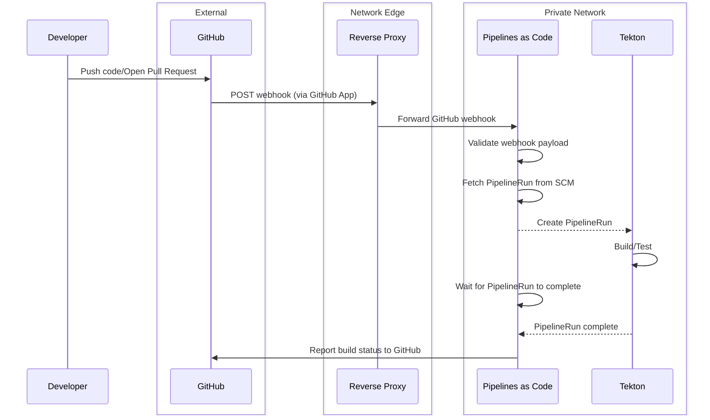

# project-euler

## Description
> Project Euler is a series of challenging mathematical/computer programming problems that will require more than just mathematical insights to solve. Although mathematics will help you arrive at elegant and efficient methods, the use of a computer and programming skills will be required to solve most problems.
> https://projecteuler.net/

This repository contains Kotlin solutions to [Project Euler](https://projecteuler.net/) problems,
and also serves as an example of various CI/CD tools. Solutions live under
`src/main/kotlin/com/github/trly/euler/solution/`, with reusable mathematical helpers under
`src/main/kotlin/com/github/trly/euler/concepts/`. Each solution is an interactive console program
exposed through its own `main()` function. The `ProblemClient` (`getProblem`) helper fetches problem
text directly from `projecteuler.net` using [jsoup](https://jsoup.org/).

## Setup

This is a Gradle project built with Kotlin (JVM). The Gradle Wrapper is committed, so a separate
Gradle installation is not required.

Prerequisites:

* JDK 21 (the build targets a JVM toolchain of language version 21)
* Kotlin 2.1.21 (resolved automatically by the Gradle Kotlin plugin)

Build the project:

```bash
./gradlew build
```

Run the tests:

```bash
./gradlew test
```

Individual problem solutions expose a `main()` function (for example,
`com.github.trly.euler.solution.one.MultiplesOfThreeOrFive`) and can be run from your IDE.

## CI/CD Tools
The following CI/CD tools are used to build and test the code in this project.

* Tekton
* Pipelines as Code
* dependabot

### [Dependabot](https://docs.github.com/en/code-security/dependabot)
> Monitor vulnerabilities in dependencies used in your project and keep your dependencies up-to-date with Dependabot.


### [Tekton](https://tekton.dev/) + [Pipelines as Code](https://pipelinesascode.com/)

Tekton is used as the primary CI solution for building and testing the code in this repository. The Pipelines as Code
project supplements Tekton and allows PipelineRun definitions to be stored alongside the source code.

The Tekton instance is running on a self-hosted [k3s](https://k3s.io/) cluster to showcase the combining of a cloud-based SCM 
on-prem CI tools.


